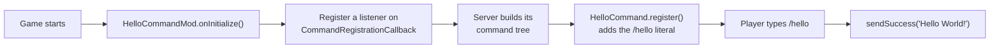

<div align="center">


# 👋 Hello Command

**A tiny, beginner-friendly Fabric mod that adds `/hello` to Minecraft.**

Type it, and the game greets you back with a golden **Hello World!** ✨

[](https://www.minecraft.net/)
[](https://fabricmc.net/)
[](https://modrinth.com/mod/fabric-api)
[](https://adoptium.net/)
[](LICENSE)

</div>

---

## 📖 Table of Contents

- [Features](#-features)
- [Preview](#-preview)
- [Installation](#-installation)
- [Building from Source](#-building-from-source)
- [How It Works](#-how-it-works)
- [Project Structure](#-project-structure)
- [Customizing](#-customizing)
- [License](#-license)

---

## ✨ Features

| | |
|---|---|
| 💬 **`/hello` command** | Replies with **Hello World!** in chat |
| 🔓 **No permissions needed** | Works for every player, even with cheats off |
| 🖥️ **Runs everywhere** | Singleplayer, LAN and dedicated servers |
| 🪶 **Lightweight** | Two small classes, no mixins, no config |
| 📚 **Documented** | Every class and method has comments explaining what it does |

## 🎬 Preview

```text
> /hello
Hello World!
```

The reply is shown in **gold** and only the player who ran the command sees it.

## 📦 Installation

1. Install **[Fabric Loader](https://fabricmc.net/use/installer/)** for **Minecraft 26.3**.
2. Download **[Fabric API](https://modrinth.com/mod/fabric-api)** for 26.3 and put it in your `mods` folder.
3. Download `hellocommand-x.y.z.jar` from the [Releases](../../releases) page (or [build it yourself](#-building-from-source)) and put it in `mods` too.
4. Launch the game and type **`/hello`** in chat. 🎉

> [!NOTE]
> On a multiplayer server, the mod has to be installed **on the server**. Players don't need it on their clients.

## 🛠️ Building from Source

**You'll need:** JDK **25** or newer. The Gradle wrapper is included, so you don't have to install Gradle.

```bash
git clone https://github.com/larynx-dev/hello-command.git
cd hello-command
./gradlew build          # on Windows: gradlew.bat build
```

The finished jar ends up in `build/libs/hellocommand-1.0.0.jar`.

### Handy Gradle tasks

| Task | What it does |
|---|---|
| `./gradlew build` | Compiles the mod and packages the jar |
| `./gradlew runClient` | Starts a development Minecraft client with the mod loaded |
| `./gradlew runServer` | Starts a development dedicated server with the mod loaded |

## 🧠 How It Works



1. **`HelloCommandMod`** is the mod's entrypoint (declared in `fabric.mod.json`). When Fabric loads it, it adds a listener to Fabric API's `CommandRegistrationCallback`.
2. Each time the server builds its command tree, that listener calls **`HelloCommand.register(...)`**.
3. `HelloCommand` uses Mojang's **Brigadier** library to add a `hello` literal node. When someone runs the command, it sends them a chat message through `CommandSourceStack#sendSuccess`.

This is the core of it:

```java
dispatcher.register(Commands.literal("hello").executes(context -> {
    context.getSource().sendSuccess(() -> Component.literal("Hello World!"), false);
    return Command.SINGLE_SUCCESS;
}));
```

## 🗂️ Project Structure

```text
hello-command/
├── build.gradle                     # Build script (Fabric Loom)
├── gradle.properties                # Minecraft, Loader & Fabric API versions
├── settings.gradle
└── src/main/
    ├── java/dev/larynx/hellocommand/
    │   ├── HelloCommandMod.java      # Entrypoint: hooks into command registration
    │   └── HelloCommand.java         # Defines /hello and what it replies
    └── resources/
        ├── fabric.mod.json           # Mod metadata, entrypoints & dependencies
        └── assets/hellocommand/icon.png
```

## 🎨 Customizing

Some easy first changes, if you're new to modding:

- **Change the reply:** edit `MESSAGE` in `HelloCommand.java`.
- **Change the colour:** swap `ChatFormatting.GOLD` for `AQUA`, `LIGHT_PURPLE` or another `ChatFormatting` value.
- **Rename the command:** change `NAME` in `HelloCommand.java` (for example to `"hi"`).
- **Greet the player by name:** use `context.getSource().getTextName()` to build the message.
- **Limit it to operators:** add `.requires(Commands.hasPermission(Commands.LEVEL_GAMEMASTERS))` before `.executes(...)`.

## 📄 License

Released under the **[MIT License](LICENSE)**, so you're free to use, change and share it.

<div align="center">

Made with ☕ and 🧱 for the Fabric community.

</div>
